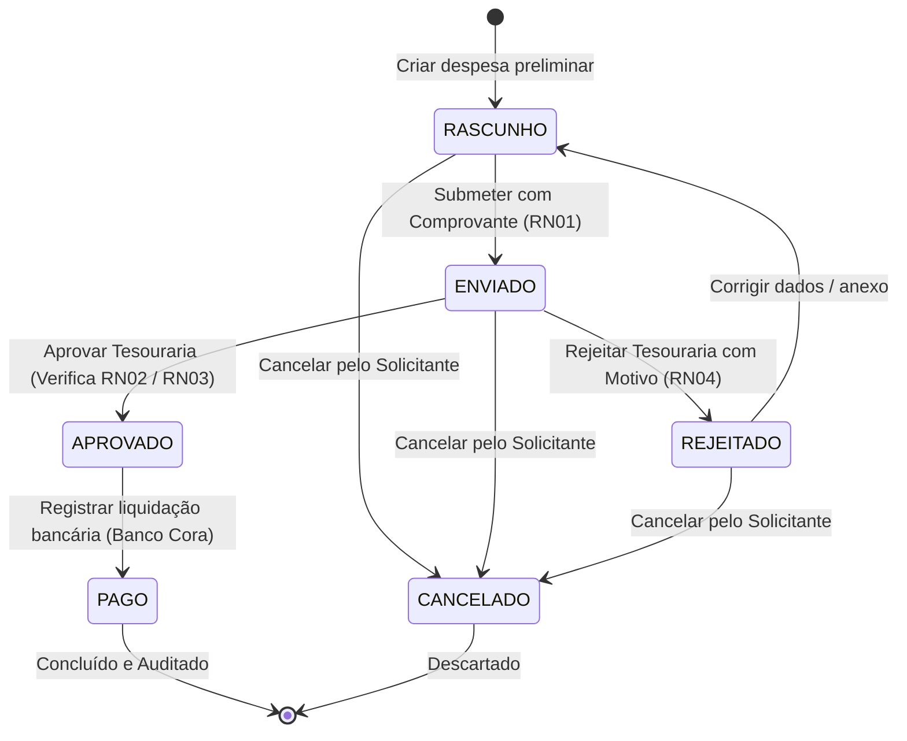

# Máquina de Estados da Despesa - SIG-Reembolso

**Projeto:** SIG-Reembolso (Acampamento Geral VII - Grupo Escoteiro Caramuru)  
**Disciplina:** Laboratório de Engenharia de Software (LES) - FATEC-SP  
**Referência:** Item 5.2 da especificação

---

## 1. Diagrama de Transição de Estados

---

## 2. Matriz de Transições e Permissões

| Estado Origem | Ação / Evento | Estado Destino | Ator Autorizado | Regras Aplicadas |
| :--- | :--- | :--- | :--- | :--- |
| *Novo* | Salvar Rascunho | `RASCUNHO` | Coordenador / Solicitante | Validação mínima de campos |
| `RASCUNHO` | Submeter Despesa | `ENVIADO` | Coordenador / Solicitante | **RN01** (Comprovante obrigatório), **RN02** (Cálculo soft-block) |
| `RASCUNHO` | Cancelar | `CANCELADO` | Solicitante | Despesa não tramitada |
| `ENVIADO` | Aprovar | `APROVADO` | Tesoureiro | **RN03** (Segregação de funções), **RN05** (Imutabilidade pós-decisão) |
| `ENVIADO` | Rejeitar | `REJEITADO` | Tesoureiro | **RN04** (Motivo obrigatório) |
| `ENVIADO` | Cancelar | `CANCELADO` | Solicitante | Caso solicite anulação antes da análise |
| `REJEITADO` | Corrigir e Reabrir | `RASCUNHO` | Solicitante | Permite atualizar foto ou valor |
| `APROVADO` | Liquidar Reembolso | `PAGO` | Tesoureiro | **RN03** (Segregação), Registro de data e anexo do PIX Cora |

---

## 3. Trilha de Auditoria
Toda transição aciona automaticamente a criação de um registro em `HistoricoTransicaoStatus`, gravando o ator, data/hora, status anterior, novo status e observações pertinentes (**RN06**).
