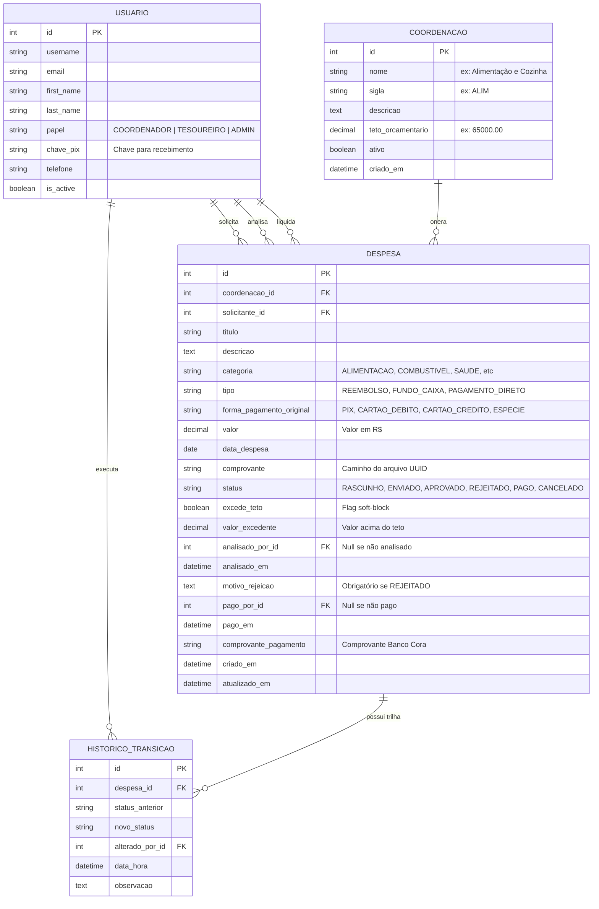

# Modelo de Dados Relacional (DER) - SIG-Reembolso

**Projeto:** SIG-Reembolso (Acampamento Geral VII - Grupo Escoteiro Caramuru)  
**Disciplina:** Laboratório de Engenharia de Software (LES) - FATEC-SP  
**Referência:** Item 5.3 da especificação

---

## 1. Diagrama de Entidade-Relacionamento (Mermaid)

---

## 2. Fórmulas e Propriedades Calculadas (`Coordenacao`)

No modelo de negócios, o teto e o saldo de cada uma das 15 coordenações são apurados dinamicamente:

$$\text{Total Comprometido} = \sum \text{Despesas}(\text{PAGO}) + \sum \text{Despesas}(\text{APROVADO}) + \sum \text{Despesas}(\text{ENVIADO})$$

$$\text{Saldo Disponível} = \text{Teto Orçamentário} - \text{Total Comprometido}$$

$$\text{Percentual Consumido (\%)} = \left( \frac{\text{Total Comprometido}}{\text{Teto Orçamentário}} \right) \times 100$$
