# Item 3.i — Procedimentos Descritivos de Testes do Sistema

**Projeto:** SIG-Reembolso
**Cliente / Evento:** Acampamento Geral VII (AG VII) — Grupo Escoteiro Caramuru
**Disciplina:** Laboratório de Engenharia de Software (LES) — FATEC-SP (DTI) — 2º semestre de 2026
**Item do edital:** 3.i — Procedimentos descritivos de testes do sistema
**Artefato:** `docs/fase-2/3i_procedimentos_testes.md`
**Responsável:** Giovanni M Costa
**Versão:** 1.0 — 26/11/2026

---

## Sumário

1. [Objetivo e escopo](#1-objetivo-e-escopo)
2. [Ambiente de testes](#2-ambiente-de-testes)
3. [Execução da suíte automatizada](#3-execução-da-suíte-automatizada)
4. [Resultado da execução](#4-resultado-da-execução)
5. [Casos de teste funcionais com evidências](#5-casos-de-teste-funcionais-com-evidências)
6. [Rastreabilidade das regras de negócio](#6-rastreabilidade-das-regras-de-negócio)
7. [Conclusão](#7-conclusão)

---

## 1. Objetivo e escopo

Este documento descreve como o SIG-Reembolso é testado e registra as evidências de execução. Há dois níveis de verificação:

- **Testes automatizados (Django `TestCase`):** validam as regras de negócio RN01 a RN06, o controle de acesso por papel (RBAC), o cálculo monetário em `Decimal`, a compressão de comprovantes (RNF02) e os relatórios.
- **Testes funcionais manuais:** percorrem o sistema pela interface, simulando o uso real por coordenadores e pela Tesouraria. Cada caso tem uma evidência em tela (print).

Fluxos cobertos nos testes funcionais: **login, envio de despesa, reprovação, liquidação e exportação CSV**.

## 2. Ambiente de testes

| Item                | Valor                                              |
| :------------------ | :------------------------------------------------- |
| Sistema operacional | Windows 11                                         |
| Python              | 3.14.4 (ambiente virtual `.venv`)                |
| Django              | 5.2.19                                             |
| Banco de dados      | SQLite (em memória durante a suíte automatizada) |
| Branch testada      | `dev` (commit `c3614e8`)                       |
| Dependências       | `src/requirements.txt`                           |

Usuários de demonstração (criados por `popular_dados_demo`) usados nos testes manuais:

| Usuário          | Papel               | Senha             |
| :---------------- | :------------------ | :---------------- |
| `coord_cozinha` | Coordenador         | `cozinha123`    |
| `coord_infra`   | Coordenador         | `infra123`      |
| `tesoureiro`    | Tesoureiro          | `tesouraria123` |
| `admin`         | Administrador Geral | `admin123`      |

> As senhas acima são exclusivamente de demonstração local.

## 3. Execução da suíte automatizada

A partir da raiz do repositório (PowerShell):

```powershell
python -m venv .venv
.venv\Scripts\Activate.ps1
pip install -r src/requirements.txt
cd src
python manage.py test -v 2
```

Para preparar os dados dos testes manuais:

```powershell
python manage.py migrate
python manage.py loaddata fixtures/coordenacoes_iniciais.json
python manage.py popular_dados_demo
python manage.py runserver
```

## 4. Resultado da execução

```
Ran 117 tests in 115.085s

OK
```

**Total: 117 testes automatizados — 117 aprovados, 0 falhas, 0 erros.**

> 📸 **Evidência 4.1:** print do terminal com a linha final `Ran 117 tests ... OK`.

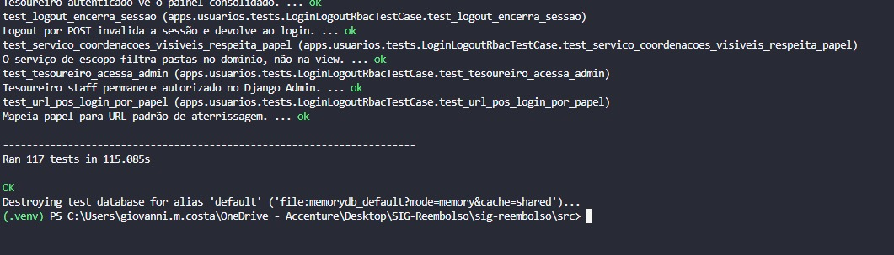

### 4.1 Distribuição por módulo

| Módulo                                                           | Arquivo                                           |    Testes    |
| :---------------------------------------------------------------- | :------------------------------------------------ | :-----------: |
| Núcleo (exceções, compressão de comprovante, carga AG VI/VII) | `core/tests.py`, `core/test_carga_ag6_ag7.py` |       8       |
| Despesas — regras RN01 a RN06 e formulário                      | `despesas/tests.py`                             |      21      |
| Despesas — soft-block e segregação                             | `despesas/test_regras_rn02_rn03.py`             |       4       |
| Despesas — tela mobile e termômetro                             | `despesas/test_tela_mobile.py`                  |      22      |
| Despesas — triagem (aprovar, rejeitar, liquidar)                 | `despesas/test_triagem_workflow.py`             |       4       |
| Despesas — painel de auditoria                                   | `despesas/test_painel_auditoria.py`             |      30      |
| Despesas — correções pós-PR #46                               | `despesas/test_correcoes_pos_pr46.py`           |       5       |
| Financeiro — saldos e tetos                                      | `financeiro/tests.py`                           |       3       |
| Relatórios — balancete e CSV                                    | `relatorios/tests.py`                           |       9       |
| Usuários — login, logout e RBAC                                 | `usuarios/tests.py`                             |      11      |
| **Total**                                                   |                                                   | **117** |

## 5. Casos de teste funcionais com evidências

Convenção: **Status** = Aprovado / Reprovado. Os prints de cada caso estão na seção 5.1 e armazenados em `docs/fase-2/assets/3i/`.

| ID   | Fluxo                                 | Pré-condição                                                   | Passos                                                                                                  | Resultado esperado                                                              | Resultado obtido | Status | Evidência                                | Teste automatizado relacionado                                                                               |
| :--- | :------------------------------------ | :---------------------------------------------------------------- | :------------------------------------------------------------------------------------------------------ | :------------------------------------------------------------------------------ | :--------------- | :----: | :---------------------------------------- | :----------------------------------------------------------------------------------------------------------- |
| CT01 | Login válido (coordenador)           | Usuário `coord_cozinha` cadastrado                             | 1. Abrir `/usuarios/login/`2. Informar usuário e senha3. Entrar                                      | Redireciona ao dashboard, exibindo só a pasta da coordenação                 | Tela de login exibida; após entrar, dashboard da coordenadora com a pasta Alimentação (ALIM).      |  Aprovado  | Ver 5.1 (CT01)                 | `usuarios.LoginLogoutRbacTestCase.test_login_coordenador_redireciona_ao_dashboard`                         |
| CT02 | Login inválido                      | Sem sessão ativa; usuário inexistente | 1. Abrir `/usuarios/login/`2. Informar usuário e senha inválidos3. Entrar| Permanece no login com mensagem de erro| Com usuário inexistente, o sistema permaneceu na tela de login e exibiu a mensagem "entre com um usuário e senha corretos".      |  Aprovado  | Ver 5.1 (CT02)             | sem teste dedicado (o redirecionamento de anônimo é coberto por `test_anonimo_e_redirecionado_do_dashboard_para_login`)                    |
| CT03 | Envio de despesa válida              | Logado como `coord_cozinha`                                     | 1. Abrir `/despesas/nova/`2. Preencher valor, descrição e categoria3. Anexar foto do cupom4. Enviar | Despesa criada com status `ENVIADO` e listada em "Minhas despesas"            | Formulário aceitou foto e valor; a despesa #101 apareceu em "Minhas despesas" com status "Em Triagem" (ENVIADO).      |  Aprovado  | Ver 5.1 (CT03)         | `despesas.DespesaSubmissaoViewFormTestCase.test_submissao_valida_com_imagem_otimizada_via_view`            |
| CT04 | Envio sem comprovante (RN01)          | Logado como coordenador                                           | 1. Abrir `/despesas/nova/`2. Preencher sem anexar foto3. Enviar                                       | Envio bloqueado com mensagem de erro clara                                      | Envio bloqueado com a mensagem "Anexe a foto ou o PDF da NF ou recibo para enviar a despesa à tesouraria".      |  Aprovado  | Ver 5.1 (CT04)       | `despesas.DespesaSubmissaoViewFormTestCase.test_bloqueio_submissao_sem_comprovante_rn01`                   |
| CT05 | Reprovação com justificativa        | Despesa `ENVIADO` de outro usuário; logado como `tesoureiro` | 1. Abrir `/despesas/triagem/`2. Abrir a despesa3. Rejeitar informando a justificativa                 | Status `REJEITADO`, justificativa registrada e saldo liberado                 | Despesa #102 ficou "Rejeitado", com o parecer registrado e visível ao tesoureiro.      |  Aprovado  | Ver 5.1 (CT05)            | `despesas.TriagemWorkflowTestCase.test_rejeitar_exige_justificativa_obrigatoria_rn04_e_libera_saldo`       |
| CT06 | Reprovação sem justificativa (RN04) | Mesma do CT05                                                     | 1. Tentar rejeitar com o campo de justificativa vazio                                                   | Ação bloqueada, status permanece `ENVIADO`                                  | O campo "Motivo da rejeição" é obrigatório: o navegador exibiu "Preencha este campo" e a rejeição não foi enviada.      |  Aprovado  | Ver 5.1 (CT06) | `despesas.DespesaRegrasNegocioTestCase.test_rn04_rejeicao_sem_motivo_lanca_excecao`                        |
| CT07 | Aprovação e liquidação            | Despesa `ENVIADO`; logado como `tesoureiro`                   | 1. Em `/despesas/triagem/`, aprovar a despesa2. Liquidar anexando o comprovante Cora PJ               | Status `APROVADO` e depois `PAGO`, com comprovante de pagamento disponível | Despesa #101 foi aprovada, exigiu o comprovante Cora PJ para registrar o pagamento e passou a "Pago".      |  Aprovado  | Ver 5.1 (CT07)            | `despesas.TriagemWorkflowTestCase.test_fluxo_aprovar_e_liquidar_com_comprovante_cora_pj`                   |
| CT08 | Segregação de funções (RN03)      | Tesoureiro dono de uma despesa `ENVIADO`                        | 1. Tentar aprovar a própria despesa                                                                    | Ação bloqueada                                                                | Na despesa do próprio tesoureiro, os botões de decisão não aparecem e o painel informa "Esta despesa é sua. Outro tesoureiro precisa decidir".      |  Aprovado  | Ver 5.1 (CT08)            | `despesas.TriagemWorkflowTestCase.test_rn03_segregacao_de_funcoes_bloqueia_auto_triagem_nos_endpoints`     |
| CT09 | Exportação CSV                      | Logado como `tesoureiro`, com despesas lançadas                | 1. Abrir `/relatorios/balancete/`2. Acionar a exportação CSV3. Abrir o arquivo no Excel             | Arquivo `.csv` baixado, com valores corretos                                  | O botão "Exportar CSV" gerou o arquivo `prestacao_contas_ag7`, aberto no Excel com id, data, coordenação, categoria, status, título, solicitante e valor.      |  Aprovado  | Ver 5.1 (CT09)          | `relatorios.PrestacaoContasRelatoriosTestCase.test_csv_filtra_categoria_e_status_com_valor_em_centavos`    |
| CT10 | CSV isolado por papel                 | Logado como coordenador (ex.: `coord_infra`)                                     | 1. Exportar o CSV                                                                                       | Só aparecem despesas da própria coordenação                                 | O CSV do coordenador trouxe apenas a despesa da própria coordenação (Infraestrutura), sem despesas de outras pastas.      |  Aprovado  | Ver 5.1 (CT10)       | `relatorios.PrestacaoContasRelatoriosTestCase.test_coordenador_nao_enxerga_outra_pasta_nem_forcando_sigla` |

### 5.1 Evidências (prints)

Todos os prints estão em `docs/fase-2/assets/3i/`, numerados na ordem de execução (mesmo padrão do item 3.j).

**CT01 — Login válido (coordenador):** tela de login e dashboard exibido após entrar, com a pasta Alimentação.

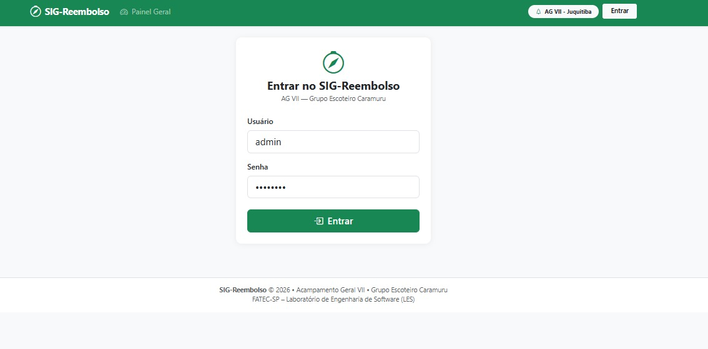

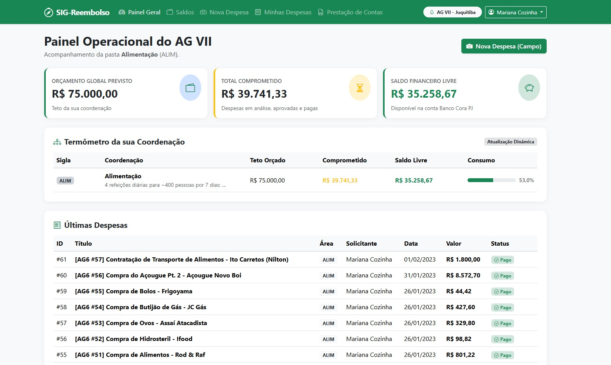

**CT02 — Login inválido:** tentativa de entrar com usuário inexistente; o sistema recusa e mantém o usuário na tela de login.

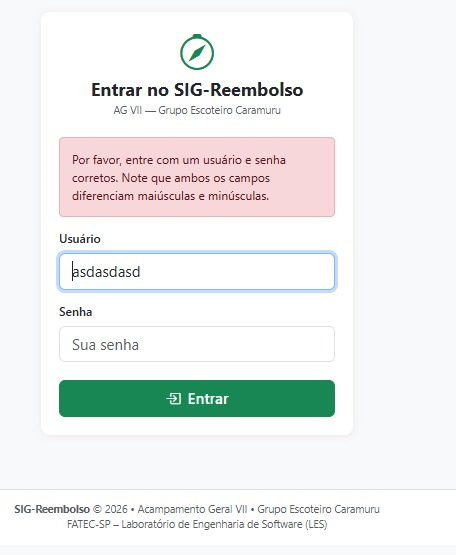

**CT03 — Envio de despesa válida:** formulário preenchido com foto e, em seguida, a despesa listada em "Minhas despesas" com status "Em Triagem".

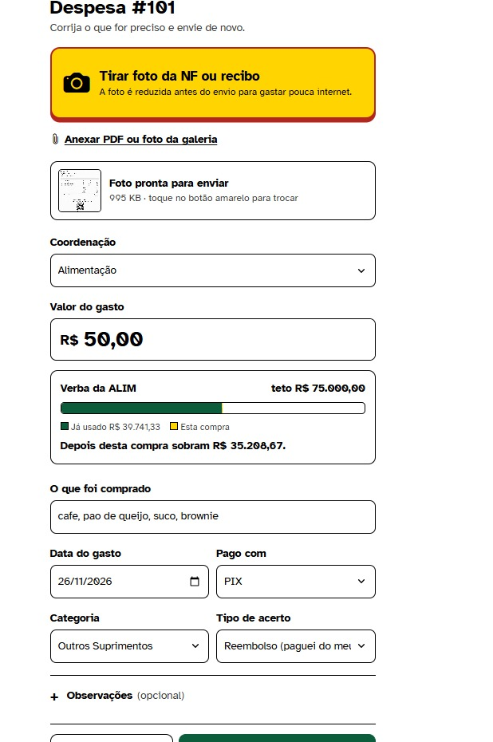

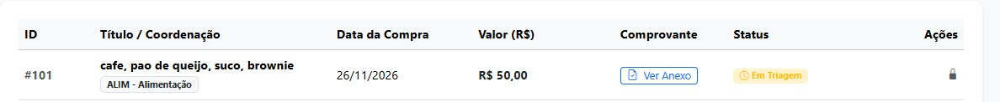

**CT04 — Envio sem comprovante (RN01):** o sistema exige o anexo da NF ou recibo antes de enviar.

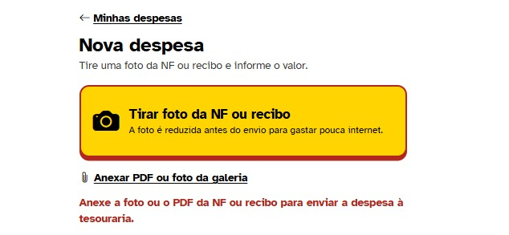

**CT05 — Reprovação com justificativa:** despesa rejeitada com parecer registrado e o histórico de notas na auditoria.

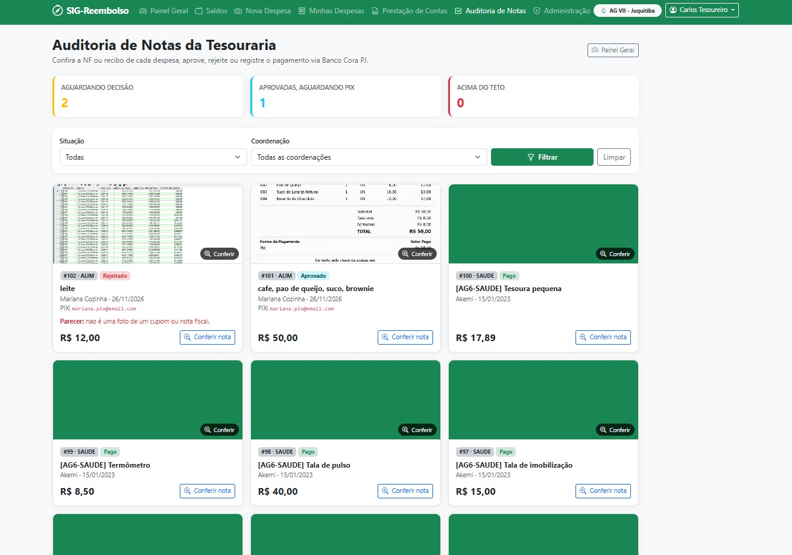

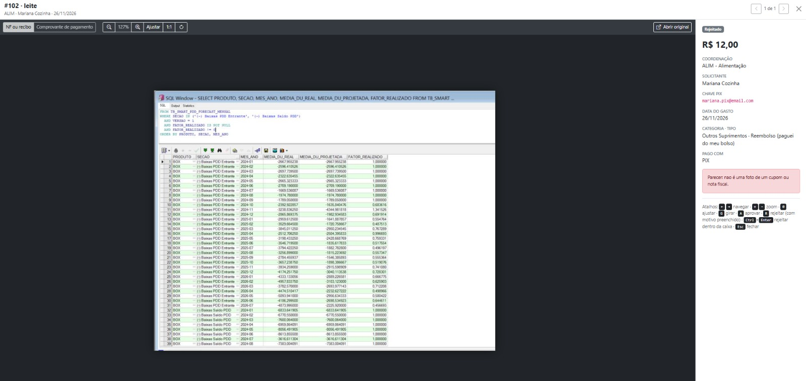

**CT06 — Reprovação sem justificativa (RN04):** tentativa de rejeitar sem informar o motivo.

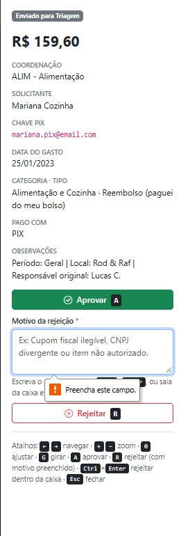

**CT07 — Aprovação e liquidação:** despesa aprovada, aguardando o comprovante Cora PJ, e depois com status "Pago".

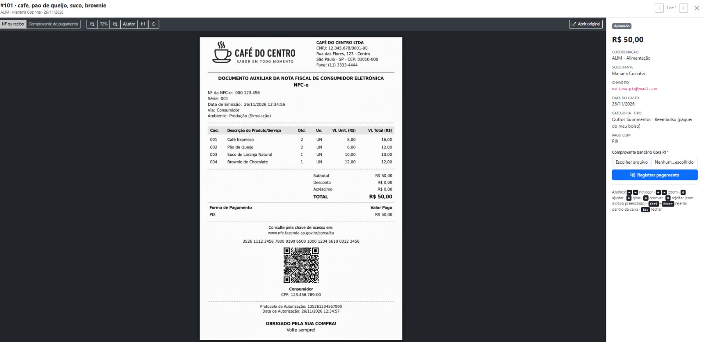

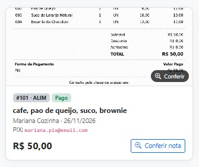

**CT08 — Segregação de funções (RN03):** na despesa lançada pelo próprio tesoureiro, as ações de aprovar e rejeitar não são oferecidas.

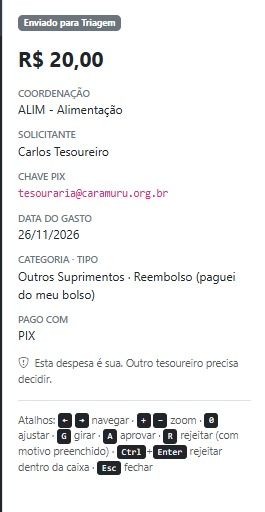

**CT09 — Exportação CSV:** tela de Prestação de Contas com o botão "Exportar CSV" e o arquivo gerado aberto no Excel.

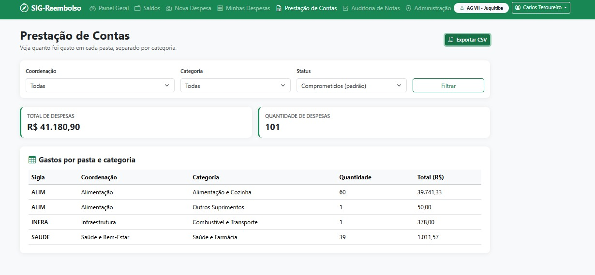

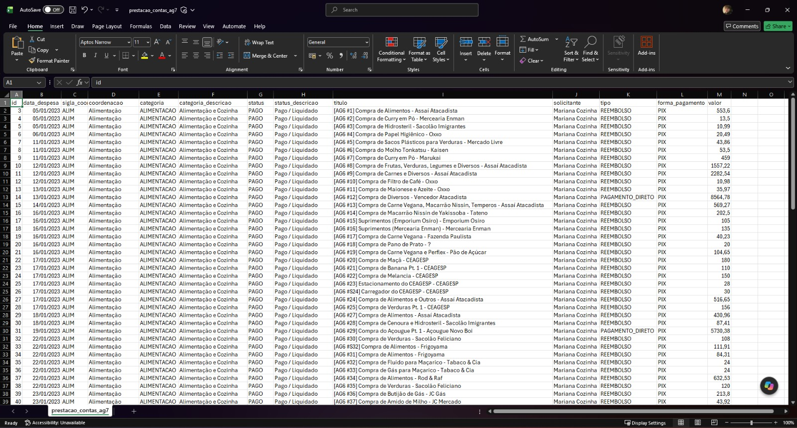

**CT10 — CSV isolado por papel:** exportação feita como coordenador.

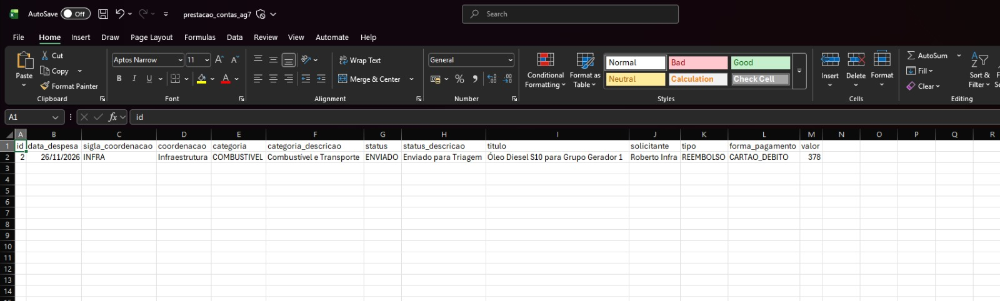


## 6. Rastreabilidade das regras de negócio

| Regra | Descrição                              | Teste automatizado                                                                                                           | Caso funcional |
| :---- | :--------------------------------------- | :--------------------------------------------------------------------------------------------------------------------------- | :------------- |
| RN01  | Comprovante obrigatório no envio        | `test_rn01_submissao_sem_comprovante_lanca_excecao`, `test_bloqueio_submissao_sem_comprovante_rn01`                      | CT04           |
| RN02  | Soft-block de estouro do teto            | `test_rn02_softblock_estouro_orcamentario`, `test_calcular_soft_block_rn02_todos_cenarios_limite`                        | —             |
| RN03  | Segregação de funções                | `test_rn03_segregacao_de_funcoes_bloqueia_auto_aprovacao`, `test_rn03_segregacao_de_funcoes_bloqueia_liquidacao_propria` | CT08           |
| RN04  | Justificativa obrigatória na rejeição | `test_rn04_rejeicao_sem_motivo_lanca_excecao`, `test_rejeitar_exige_justificativa_obrigatoria_rn04_e_libera_saldo`       | CT05, CT06     |
| RN05  | Imutabilidade após aprovação          | `test_rn05_imutabilidade_pos_decisao`, `test_rn05_bloqueia_alteracao_de_comprovante_em_despesa_aprovada`                 | —             |
| RN06  | Auditoria imutável das transições     | `test_rn06_auditoria_imutavel_registra_transicoes`                                                                         | —             |
| RNF02 | Compressão de comprovantes              | `test_rnf02_compressao_imagem_pesada_mantem_limite_350kb`                                                                  | CT03           |

## 7. Conclusão

A suíte automatizada executou 117 testes sem falhas, cobrindo as regras RN01 a RN06, o controle de acesso por papel, o cálculo monetário e os relatórios. Os casos funcionais CT01 a CT10 complementam a suíte validando o comportamento percebido pelo usuário. Na execução manual, os dez casos (CT01 a CT10) tiveram o resultado esperado e foram aprovados, sem defeitos encontrados. Os fluxos de login, envio de despesa, reprovação, liquidação e exportação CSV funcionaram de ponta a ponta, e as regras RN01 (comprovante), RN03 (segregação de funções) e RN04 (justificativa na rejeição) foram observadas na interface. Pendências: não foi gerada a cobertura percentual do código, e os casos CT02, CT06 e CT08 se apoiam também em testes automatizados para a validação do lado servidor.
