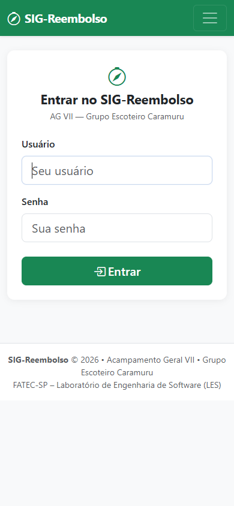
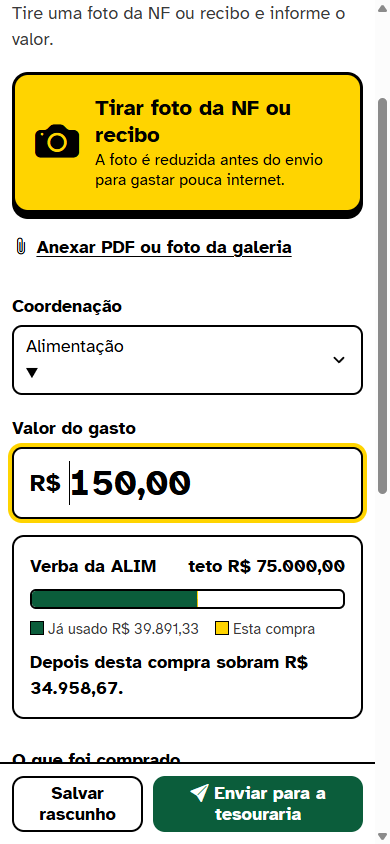
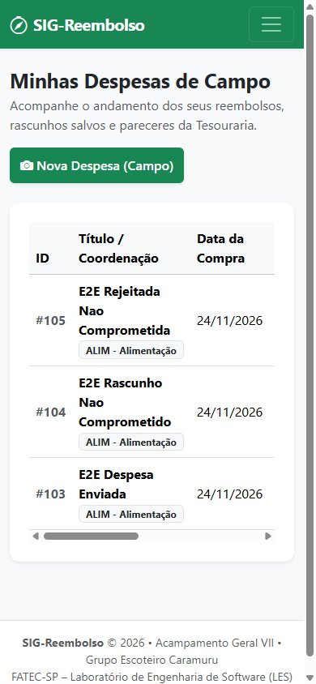
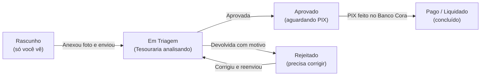
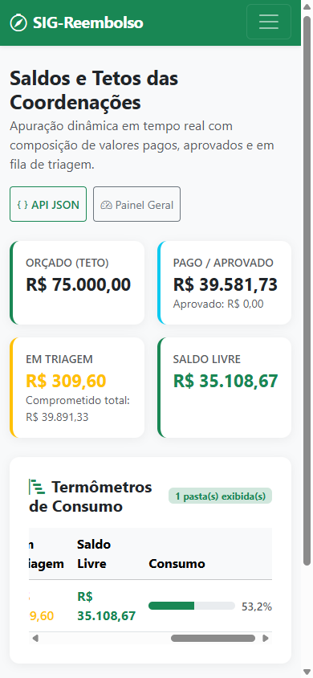

# Item 3.j — Manual de Operação do Sistema (Guia dos Voluntários de Campo)

**Projeto:** SIG-Reembolso  
**Cliente / Evento:** Acampamento Geral VII (AG VII) — Grupo Escoteiro Caramuru  
**Disciplina:** Laboratório de Engenharia de Software (LES) — FATEC-SP (DTI) — 2º semestre de 2026  
**Item do edital:** 3.j — Manual de operação do sistema  
**Artefato:** `docs/fase-2/3j_manual_operacao.md`  
**Responsável:** Gustavo Minoru Haga (`@minoruhaga`) — [Issue #19](https://github.com/minoruhaga/sig-reembolso/issues/19)  
**Versão:** 1.0 — 26/11/2026

---

## Sumário

1. [Para quem é este manual](#1-para-quem-é-este-manual)
2. [Como acessar e fazer login no celular](#2-como-acessar-e-fazer-login-no-celular)
3. [Guia de boas práticas para fotografar cupons e notas fiscais](#3-guia-de-boas-práticas-para-fotografar-cupons-e-notas-fiscais)
4. [Passo a passo: como lançar uma Nova Despesa](#4-passo-a-passo-como-lançar-uma-nova-despesa)
5. [Entendendo o Termômetro de Verba e o aviso de estouro](#5-entendendo-o-termômetro-de-verba-e-o-aviso-de-estouro)
6. [Como usar o modo Rascunho (sem sinal ou foto pendente)](#6-como-usar-o-modo-rascunho-sem-sinal-ou-foto-pendente)
7. [Acompanhando seus pedidos em Minhas Despesas](#7-acompanhando-seus-pedidos-em-minhas-despesas)
8. [Como corrigir e reenviar uma despesa rejeitada](#8-como-corrigir-e-reenviar-uma-despesa-rejeitada)
9. [Consultando Saldos e Prestação de Contas da sua pasta](#9-consultando-saldos-e-prestação-de-contas-da-sua-pasta)
10. [Dúvidas frequentes em campo (FAQ)](#10-dúvidas-frequentes-em-campo-faq)
11. [Referências](#11-referências)

---

## 1. Para quem é este manual

Este guia foi escrito para os **voluntários e coordenadores das 15 coordenações operacionais** do Acampamento Geral VII (AG VII) que fazem compras de campo (alimentação, saúde/farmácia, combustível, infraestrutura, programa e suprimentos) e precisam pedir reembolso ou prestar contas de fundo de caixa pelo celular.

Você **não precisa instalar nenhum aplicativo** da loja do celular: o SIG-Reembolso funciona direto no navegador (Chrome no Android ou Safari no iPhone) e foi preparado para telas de smartphone, luz solar direta e conexão limitada do Campo Escola de Juquitiba/SP.

> **Nota sobre outros perfis:** Este manual cobre a operação diária dos **coordenadores e voluntários de campo**. Os procedimentos de triagem, aprovação, rejeição, liquidação via Banco Cora PJ e administração de tetos pela **Tesouraria** são tratados no **Item 3.k (Manual de Treinamento do Sistema)**.

---

## 2. Como acessar e fazer login no celular

### 2.1 Onde conectar
No Campo Escola de Juquitiba, o sinal de celular (4G/5G) é instável. Sempre que precisar acessar o sistema dentro do acampamento, conecte o aparelho ao **Wi-Fi da antena Starlink** disponível na **Secretaria** ou na **Tesouraria**.

### 2.2 Passo a passo de acesso
1. Abra o navegador do celular (**Google Chrome** no Android ou **Safari** no iPhone).
2. Digite o endereço do SIG-Reembolso informado pela Coordenação do AG VII (em ambiente local de demonstração: `http://127.0.0.1:8000/usuarios/login/`).
3. Informe o seu **Usuário** e a sua **Senha** entregues pela Tesouraria no início do evento.
4. Toque no botão verde **Entrar**.

> **Dica prática de campo (atalho na tela inicial):**
> - **Android (Chrome):** toque nos três pontinhos (`⋮`) no canto superior direito $\rightarrow$ **Adicionar à tela inicial**.
> - **iPhone (Safari):** toque no ícone de compartilhar (`↑`) na barra inferior $\rightarrow$ **Adicionar à Tela de Início**.
>
> Assim o SIG-Reembolso fica como um ícone na tela do celular, pronto para abrir em 1 toque.

### 2.3 O que você vê após entrar
Cada coordenador visualiza **somente os dados, tetos e despesas da própria coordenação** (por exemplo, quem coordena Alimentação vê apenas a pasta `ALIM`). Para encerrar o uso em um aparelho compartilhado, toque no seu nome no menu superior e escolha **Sair**.

---

## 3. Guia de boas práticas para fotografar cupons e notas fiscais

O principal motivo de atraso ou devolução de reembolsos em acampamentos é a foto ilegível ou o extravio do cupom térmico. O SIG-Reembolso **reduz automaticamente o tamanho da foto** para menos de **350 KB** antes de salvar, garantindo envio rápido mesmo na rede compartilhada da Starlink — mas a qualidade inicial da foto depende de alguns cuidados simples.

### 3.1 Checklist antes de apertar o botão da câmera

| Faça assim (recomendado) | Evite (causa reprovação na Tesouraria) |
| :--- | :--- |
| Apoie o cupom sobre uma **superfície plana e escura** (mesa, prancheta ou banco) para dar contraste ao papel branco. | Segurar o cupom no ar com os dedos cobrindo valores ou datas. |
| Fotografe **de cima para baixo** (celular paralelo ao papel), enquadrando a nota inteira. | Tirar foto inclinada ou muito distante, deixando os números minúsculos. |
| Busque **luz uniforme** (sombra clara ou luz interna), evitando sombras do próprio celular sobre o texto. | Usar flash direto em papel térmico brilhante (cria clarão branco que apaga o valor). |
| Confira se **CNPJ/estabelecimento, data da compra e valor total** estão legíveis na prévia antes de enviar. | Enviar foto tremida, cortada no rodapé (onde fica o total) ou com cupom amassado/molhado sem esticar. |
| Para notas fiscais eletrônicas recebidas por WhatsApp/e-mail, anexe diretamente o **arquivo PDF**. | Tirar foto da tela de outro celular quando você já tem o PDF original. |

### 3.2 Formatos aceitos
- **Imagens:** `JPG/JPEG`, `PNG` e `WEBP` (tiradas na hora pela câmera ou escolhidas na galeria).
- **Documentos:** `PDF` (ideal para DANFE, boletos e recibos digitais).

> **Dica de campo:** Tire a foto **ainda no caixa ou no estacionamento da loja**, antes de guardar o cupom no bolso (onde o papel térmico amassa, molha ou apaga com o calor). Se estiver sem internet na cidade, tire a foto pela câmera normal do celular e anexe pela galeria assim que voltar ao Wi-Fi da Secretaria.

---

## 4. Passo a passo: como lançar uma Nova Despesa

1. No menu superior, toque em **Nova Despesa** (ou no botão verde **Nova Despesa (Campo)** no Painel Geral).
2. **Toque no botão grande da câmera — "Tirar foto da NF ou recibo":**
   - No celular, o sistema abre diretamente a câmera traseira (`environment`) ou permite escolher uma foto/PDF salvo no aparelho.
   - Assim que você seleciona o arquivo, uma prévia aparece na tela para conferência.
3. **Digite o Valor do gasto (R\$):**
   - Basta digitar os números (incluindo os centavos): por exemplo, digitar `15000` preenche automaticamente `150,00`.
   - Enquanto você digita, o **Termômetro de Verba** logo abaixo atualiza automaticamente quanto ainda sobra na sua coordenação.
4. **Preencha os demais campos:**
   - **Coordenação:** já vem selecionada com a sua pasta (ex.: `ALIM - Alimentação`).
   - **Título:** escreva de forma curta e clara o que foi comprado (ex.: *"Verduras e temperos — Sacolão Juquitiba"*).
   - **Categoria:** escolha a natureza do gasto (*Alimentação*, *Combustível*, *Saúde e Farmácia*, *Programa*, *Infraestrutura*, *Locação* ou *Outros*).
   - **Tipo de acerto:** indique se foi **Reembolso** (pagou do próprio bolso), **Fundo de Caixa** (usou dinheiro adiantado pela Tesouraria) ou **Pagamento Direto**.
   - **Forma de pagamento:** selecione *PIX*, *Cartão de Débito*, *Cartão de Crédito*, *Dinheiro/Espécie* ou *Boleto*.
   - **Data da despesa:** informe a data impressa no cupom fiscal (o sistema sugere a data de hoje).
   - **Observações (opcional):** use para detalhar nome da loja ou justificativa extra, principalmente se a compra passar do teto.
5. **Finalize o lançamento:**
   - Toque em **Enviar para a Tesouraria** (exige foto ou PDF anexado).
   - Ou toque em **Salvar como Rascunho** caso ainda precise complementar algum dado ou anexar a foto depois.

---

## 5. Entendendo o Termômetro de Verba e o aviso de estouro

O **Termômetro de Verba** mostra em tempo real quanto do orçamento da sua coordenação já foi comprometido (soma de despesas *Em Triagem*, *Aprovadas* e *Pagas*) e quanto ainda ficará livre **depois da compra que você está digitando**.

- **Barra verde (até 60% do teto):** orçamento confortável.
- **Barra amarela (acima de 60% até 90%):** atenção ao saldo restante da pasta.
- **Barra vermelha (acima de 90% ou estouro):** verba no limite ou ultrapassada.

### E se a compra urgente passar do teto da minha coordenação?
**O sistema NÃO trava o envio.** Em um acampamento, uma compra emergencial (como um remédio na madrugada ou um item essencial da cozinha) não pode esperar.

Se o valor ultrapassar o saldo livre da sua pasta:
1. O termômetro exibe um **aviso em destaque** informando exatamente em quantos reais a compra excede o teto.
2. Você consegue clicar em **Enviar para a Tesouraria** normalmente.
3. A solicitação chega marcada em vermelho para a Tesouraria, que avalia e decide pela liberação de verba extraordinária.

> **Boa prática:** Sempre que aparecer o aviso de estouro, escreva brevemente no campo **Observações** o motivo da urgência — isso acelera a aprovação pela Tesouraria.

---

## 6. Como usar o modo Rascunho (sem sinal ou foto pendente)

Você pode salvar uma compra como **Rascunho** quando:
- ainda não está com o cupom fiscal em mãos;
- quer registrar o valor rapidamente para não esquecer e anexar o PDF depois;
- precisa revisar algum dado antes de mandar para conferência.

**Importante sobre Rascunhos:**
- Rascunhos **não consomem o saldo** do termômetro nem aparecem na fila da Tesouraria.
- Você pode editar todos os campos do rascunho quantas vezes precisar em **Minhas Despesas**.
- Quando anexar a foto/PDF e clicar em **Enviar para a Tesouraria**, a despesa entra oficialmente na fila de triagem.

---

## 7. Acompanhando seus pedidos em Minhas Despesas

Toque em **Minhas Despesas** no menu superior para ver o histórico completo de tudo o que você lançou, com o status atualizado em tempo real.

### Ciclo de vida do seu reembolso

### Significado de cada status

| Status na tela | O que significa | O que você precisa fazer |
| :--- | :--- | :--- |
| **Rascunho** | Salvo apenas para você; ainda não foi enviado. | Abrir em **Editar**, anexar o comprovante e enviar. |
| **Em Triagem** | Já está na fila de conferência da Tesouraria. | Aguardar a análise (o valor já está reservado no termômetro). |
| **Aprovado** | Nota conferida e aceita; liberada para pagamento. | Aguardar a transferência PIX da Tesouraria. *(Não pode mais ser editada.)* |
| **Rejeitado** | A Tesouraria encontrou um problema e devolveu com justificativa. | Ler o motivo exibido na tela, corrigir e reenviar (veja a seção 8). |
| **Pago / Liquidado** | Reembolso transferido via Banco Cora PJ. | Nada — processo concluído! *(Despesa travada para auditoria.)* |
| **Cancelado** | Solicitação encerrada sem pagamento. | Nenhuma ação necessária. |

---

## 8. Como corrigir e reenviar uma despesa rejeitada

Se a Tesouraria reprovar uma solicitação (por exemplo, foto tremida, valor diferente do cupom ou recibo incompleto), o sistema **sempre exibe o motivo exato da reprovação** junto à despesa na tela **Minhas Despesas**.

Para regularizar:
1. Acesse **Minhas Despesas** e localize o item marcado como **Rejeitado**.
2. Leia o motivo informado pela Tesouraria.
3. Toque no botão **Editar** daquela despesa.
4. Faça o ajuste necessário (por exemplo, tire uma nova foto mais nítida do cupom ou corrija o valor digitado).
5. Toque em **Enviar para a Tesouraria** para recolocar o pedido na fila de triagem.

> **Atenção:** Despesas já **Aprovadas** ou **Pagas** ficam permanentemente travadas contra alteração para garantir a segurança contábil do evento.

---

## 9. Consultando Saldos e Prestação de Contas da sua pasta

Além de lançar compras, você pode acompanhar a saúde financeira da sua coordenação em duas telas do menu superior:

### 9.1 Tela "Saldos"
Mostra os cards consolidados da sua coordenação (**Orçado/Teto**, **Pago/Aprovado**, **Em Triagem** e **Saldo Livre**) e a barra visual de consumo percentual.

### 9.2 Tela "Prestação de Contas"
Permite visualizar o total gasto na sua coordenação separado por categoria (por exemplo, *Alimentação e Cozinha*, *Combustível e Transporte*):
- Por padrão, o balancete soma apenas as despesas **Comprometidas** (*Em Triagem*, *Aprovadas* e *Pagas*), batendo exatamente com o **Painel Geral** e com a tela **Saldos**.
- Se quiser consultar rascunhos ou notas rejeitadas, basta selecionar o status desejado no filtro **Status** e tocar em **Filtrar**.
- O botão verde **Exportar CSV** baixa a planilha com exatamente o mesmo recorte exibido na tela para abrir no Excel ou Google Planilhas.

---

## 10. Dúvidas frequentes em campo (FAQ)

**1. Esqueci minha senha ou não consigo entrar.**  
Procure um voluntário da **Tesouraria** na Secretaria do acampamento para redefinição da senha.

**2. Cliquei em "Enviar para a Tesouraria", mas o sistema pediu comprovante.**  
Nenhuma despesa pode ir para triagem sem foto ou PDF da nota/recibo. Anexe o comprovante no botão da câmera ou use **Salvar como Rascunho** até conseguir o documento.

**3. Tentei enviar uma foto e deu erro de formato ou arquivo corrompido.**  
Verifique se o arquivo é `JPG`, `PNG`, `WEBP` ou `PDF`. Se a foto foi tirada em formato proprietário ou corrompeu durante a captura, tire uma nova foto diretamente pelo botão da câmera do formulário.

**4. Por que só aparece a minha coordenação no campo "Coordenação"?**  
Por segurança e organização financeira, cada coordenador só pode lançar despesas na própria pasta. Caso você tenha feito uma compra em nome de outra coordenação, combine com o coordenador daquela pasta ou com a Tesouraria.

**5. Minha despesa já foi aprovada e percebi um erro de digitação no valor. Consigo editar?**  
Não. Após a aprovação ou pagamento, o sistema bloqueia edições para manter o histórico contábil íntegro. Avise a Tesouraria diretamente na Secretaria.

**6. A tela demorou para carregar no campo.**  
Verifique se o celular está conectado ao Wi-Fi da **Starlink** na Secretaria/Tesouraria. As fotos enviadas pelo sistema já são compactadas automaticamente (< 350 KB) para funcionar mesmo com conexão lenta.

---

## 11. Referências

- [Item 3.g — Definição das interfaces com base na usabilidade](3g_interfaces_usabilidade.md)
- [Item 3.h — Documentação do sistema desenvolvido](3h_documentacao_sistema.md)
- [Requisitos Funcionais (RF01–RF08)](../requisitos/requisitos_funcionais.md)
- [Requisitos Não Funcionais (RNF01–RNF05)](../requisitos/requisitos_nao_funcionais.md)
- [Regras de Negócio (RN01–RN06)](../requisitos/regras_de_negocio.md)
- [Guia de Login e RBAC](guia-login-rbac.md)
