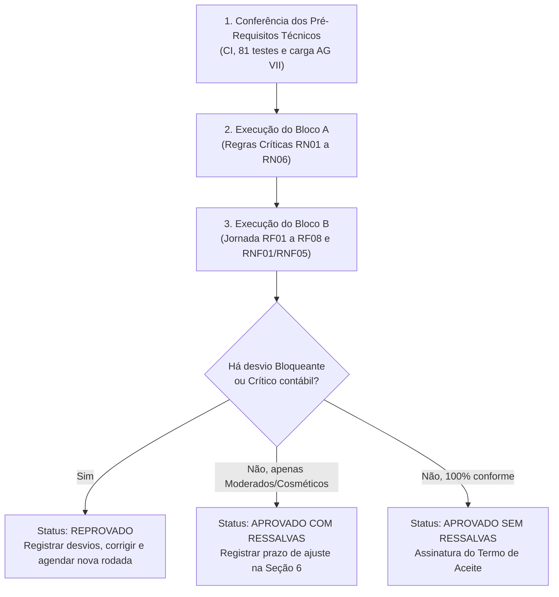

# Item 3.l — Procedimentos de Homologação e Aprovação do Sistema

**Projeto:** SIG-Reembolso (Sistema Integrado de Gestão de Fundo de Caixa, Adiantamentos e Reembolsos)  
**Cliente / Caso Real:** Coordenação Executiva do Acampamento Geral VII (AG VII) — Grupo Escoteiro Caramuru  
**Disciplina:** Laboratório de Engenharia de Software (LES) — FATEC-SP (DTI) — 2º semestre de 2026  
**Item do edital:** 3.l — Procedimentos de homologação (aprovação) do sistema  
**Artefato:** `docs/fase-2/3l_homologacao_sistema.md`  
**Responsável:** Gustavo Minoru Haga (`@minoruhaga`, Product Owner) — [Issue #20](https://github.com/minoruhaga/sig-reembolso/issues/20)  
**Versão:** 1.0 — 26/11/2026

---

## Sumário

1. [Objetivo, escopo e aderência ao edital](#1-objetivo-escopo-e-aderência-ao-edital)
2. [Papéis e participantes da sessão de homologação](#2-papéis-e-participantes-da-sessão-de-homologação)
3. [Pré-requisitos e preparação do ambiente](#3-pré-requisitos-e-preparação-do-ambiente)
4. [Critérios de aprovação e classificação de desvios](#4-critérios-de-aprovação-e-classificação-de-desvios)
5. [Roteiro formal de testes de aceitação (UAT)](#5-roteiro-formal-de-testes-de-aceitação-uat)
6. [Registro de desvios e ressalvas](#6-registro-de-desvios-e-ressalvas)
7. [Minuta formal do Termo de Homologação e Aceite do Sistema](#7-minuta-formal-do-termo-de-homologação-e-aceite-do-sistema)
8. [Referências](#8-referências)

---

## 1. Objetivo, escopo e aderência ao edital

Este documento estabelece os **procedimentos formais de homologação (Testes de Aceitação do Usuário — UAT)** e apresenta a **minuta oficial do Termo de Homologação e Aceite do Sistema** do **SIG-Reembolso**, junto ao cliente real (**Coordenação Executiva Geral e Coordenação Financeira do Acampamento Geral VII — Grupo Escoteiro Caramuru**).

| Exigência do Item 3.l e da Issue #20 | Onde está atendida neste documento |
| :--- | :--- |
| Procedimento estruturado de homologação com o cliente real | [Seções 2, 3 e 4](#2-papéis-e-participantes-da-sessão-de-homologação) |
| Roteiro de testes de aceitação cobrindo regras contábeis críticas (`RN01` a `RN06`) | [Seção 5 — Bloco A](#51-bloco-a--regras-de-negócio-contábeis-críticas-rn01-a-rn06) |
| Roteiro funcional ponta a ponta (`RF01` a `RF08` e `RNF01`–`RNF05`) | [Seção 5 — Bloco B](#52-bloco-b--jornada-funcional-e-requisitos-operacionais-rf01-a-rf08-e-rnf) |
| Registro formal de não conformidades e ressalvas | [Seção 6](#6-registro-de-desvios-e-ressalvas) |
| Minuta do Termo de Homologação e Aceite preenchida para assinatura | [Seção 7](#7-minuta-formal-do-termo-de-homologação-e-aceite-do-sistema) |

---

## 2. Papéis e participantes da sessão de homologação

| Papel na homologação | Representação / Identificação | Responsabilidade na sessão |
| :--- | :--- | :--- |
| **Patrocinador / Cliente Executivo** | **Coordenação Executiva Geral do AG VII** / Diretoria do **Grupo Escoteiro Caramuru** | Validar alinhamento ao escopo operacional do evento e assinar o aceite institucional final. |
| **Cliente Operacional Financeiro** | **Coordenação Financeira / Tesouraria do AG VII** (custódia Banco Cora PJ) | Executar e validar os cenários de triagem, segregação de funções, soft-block, liquidação e prestação de contas. |
| **Usuários-chave de Campo (Piloto)** | Coordenadores de áreas operacionais (ex.: Alimentação — `ALIM`, Infraestrutura — `INFRA`, Saúde — `SAUDE`) | Executar lançamentos mobile em smartphone (foto do cupom, rascunho, acompanhamento e correção de rejeições). |
| **Equipe Técnica — FATEC-SP (LES)** | **Gustavo Minoru Haga** (`@minoruhaga` — Tech Lead / PO), **Marina** (`@Mah-Rod` — Auth/RBAC & Relatórios), **Ricardo Sakugawa** (`@ricardosakugawa` — Frontend/UX) e **Giovanni** (`@xixinho` — QA) | Conduzir o ambiente de demonstração/homologação, registrar evidências, classificar eventuais desvios e coletar o termo assinado. |

---

## 3. Pré-requisitos e preparação do ambiente

Antes de iniciar a sessão presencial ou remota de homologação com o cliente, a equipe técnica deve confirmar todos os itens abaixo:

- [ ] **Código integrado:** branch `dev` atualizada no repositório `minoruhaga/sig-reembolso`, com todas as entregas funcionais e correções mergeadas e CI verde.
- [ ] **Verificações automáticas aprovadas (baseline técnico):**
  - `ruff check src` sem erros ou avisos pendentes;
  - `python src/manage.py check` retornando `0 silenced`;
  - `python src/manage.py makemigrations --check --dry-run` sem migrações pendentes;
  - `python src/manage.py test src/apps --verbosity=1` com os **81 testes automatizados** passando.
- [ ] **Massa de dados real carregada:** execução de `python src/manage.py migrate` e `python src/manage.py carregar_dados_ag6_ag7` carregando as **15 coordenações operacionais** do AG VII (orçamento total modelado de **R\$ 193.320,00** em `src/fixtures/coordenacoes_iniciais.json`).
- [ ] **Contas de teste disponíveis para os papéis da sessão:**
  - `1` conta com papel **Coordenador** vinculada à pasta `ALIM` (e opcionalmente uma segunda conta vinculada a `SAUDE` para validar isolamento entre pastas);
  - `2` contas distintas com papel **Tesoureiro** (`Tesoureiro A` e `Tesoureiro B`) para comprovar a regra de segregação de funções (`RN03`);
  - `1` conta com papel **Administrador Geral** para verificação do painel administrativo e trilha de auditoria.
- [ ] **Dispositivos e rede de validação:**
  - `1` smartphone (Android ou iOS, largura entre `360 px` e `430 px`) com câmera funcional ou imagens de teste (> 1 MB para validar compressão `< 350 KB`) e arquivo `.pdf`;
  - `1` notebook/desktop para o painel de triagem da Tesouraria e abertura do arquivo `.csv` exportado no Excel ou LibreOffice Calc.

---

## 4. Critérios de aprovação e classificação de desvios

### 4.1 Fluxo da sessão de homologação

### 4.2 Classificação de desvios

| Severidade | Definição objetiva | Efeito sobre o aceite |
| :--- | :--- | :--- |
| **Bloqueante** | Impede o funcionamento do sistema, causa erro HTTP 500 ou viola `RN01`–`RN06` / isolamento RBAC / precisão monetária `Decimal`. | **Impede a homologação** até correção e reteste. |
| **Crítica** | Fluxo principal falha sem contorno operacional ou gera divergência entre saldos exibidos (`Painel Geral`, `Saldos` e `Prestação de Contas`). | **Impede a homologação** até correção e reteste. |
| **Moderada** | Comportamento funcional parcial com contorno claro e sem perda financeira/contábil. | Permite **Aprovação com Ressalvas**, com prazo acordado. |
| **Cosmética** | Ajuste de texto, rótulo ou alinhamento visual sem impacto funcional ou contábil. | Permite **Aprovação com Ressalvas** ou registro para backlog. |

### 4.3 Critério de deliberação final
- **APROVADO SEM RESSALVAS:** 100% dos casos `UAT-RN01` a `UAT-RN06` aprovados e nenhum desvio Bloqueante, Crítico ou Moderado em aberto.
- **APROVADO COM RESSALVAS:** 100% dos casos `UAT-RN01` a `UAT-RN06` aprovados, zero desvios Bloqueantes/Críticos, podendo haver ajustes Moderados ou Cosméticos registrados na Seção 6 com prazo de entrega definido.
- **REPROVADO (Nova Rodada Obrigatória):** ocorrência de qualquer desvio Bloqueante ou Crítico (em especial qualquer falha nas regras contábeis `RN01` a `RN06`).

---

## 5. Roteiro formal de testes de aceitação (UAT)

### 5.1 Bloco A — Regras de negócio contábeis críticas (`RN01` a `RN06`)

#### `UAT-RN01` — Obrigatoriedade de comprovante fiscal na submissão (`RN01`, `RF04`, `RF05`, `RNF02`, `RNF04`)
- **Perfil executor:** Coordenador de Área (`ALIM`), em smartphone (`360–430 px`).
- **Pré-condição:** Usuário autenticado em `/despesas/nova/` com uma foto de cupom (`> 1 MB`) e um documento `.pdf` disponíveis no aparelho.
- **Passos:**
  1. Preencher título, categoria, tipo, forma de pagamento, data e valor (`R$ 150,00`) **sem anexar arquivo** e clicar em **Enviar para a Tesouraria**.
  2. Com os mesmos dados ainda **sem arquivo**, clicar em **Salvar como Rascunho**.
  3. Abrir o rascunho em **Minhas Despesas** $\rightarrow$ **Editar**, anexar a foto (`> 1 MB`) pelo botão da câmera e clicar em **Enviar para a Tesouraria**.
- **Resultado esperado:**
  - Passo 1 bloqueia o envio informando que o comprovante é obrigatório (`RN01`).
  - Passo 2 grava a despesa com status `Rascunho` sem consumir o saldo do termômetro (`RF05`).
  - Passo 3 comprime a imagem para `< 350 KB` (`RNF02`), renomeia o arquivo com identificador UUID v4 (`RNF04`), muda o status para `Em Triagem` (`ENVIADO`) e atualiza o saldo comprometido da pasta.
- **Evidência:** Captura da validação, tamanho do arquivo em disco (`< 350 KB`) e linha da despesa em `Minhas Despesas`.
- **Status:** `[ ] Aprovado   [ ] Ressalva   [ ] Reprovado`

---

#### `UAT-RN02` — Estouro orçamentário com *Soft-Block* e alerta (`RN02`, `RF03`)
- **Perfil executor:** Coordenador de Área (`ALIM`) + Tesoureiro.
- **Pré-condição:** Coordenação `ALIM` possui saldo livre conhecido (ex.: `R$ 35.108,67`).
- **Passos:**
  1. Como Coordenador em `/despesas/nova/`, digitar um valor **superior** ao saldo livre atual (ex.: `R$ 40.000,00`), observar o termômetro ao vivo, anexar comprovante e clicar em **Enviar para a Tesouraria**.
  2. Como Tesoureiro em `/despesas/triagem/`, localizar a solicitação recém-enviada.
- **Resultado esperado:**
  - O sistema exibe alerta de estouro no termômetro informando o excedente exato em R\$, mas **não impede** o envio da compra emergencial.
  - Na fila da Tesouraria, a solicitação aparece priorizada no topo com badge vermelho de estouro (`ESTOURO DE TETO` / valor excedente calculado em `Decimal`).
- **Evidência:** Mensagem de alerta exibida ao coordenador e destaque visual na fila da Tesouraria.
- **Status:** `[ ] Aprovado   [ ] Ressalva   [ ] Reprovado`

---

#### `UAT-RN03` — Segregação de funções (*Duty Segregation*) (`RN03`, `RF06`)
- **Perfil executor:** `Tesoureiro A` (solicitante) e `Tesoureiro B` (analisador).
- **Pré-condição:** Duas contas distintas com perfil `Tesoureiro` ativas.
- **Passos:**
  1. Logado como `Tesoureiro A`, lançar e enviar uma despesa (`ENVIADO`) com comprovante válido.
  2. Ainda como `Tesoureiro A`, abrir `/despesas/triagem/` e verificar os botões de ação dessa própria despesa (e tentar aprovar/rejeitar).
  3. Fazer login como `Tesoureiro B`, abrir `/despesas/triagem/` e aprovar a despesa criada por `Tesoureiro A`.
- **Resultado esperado:**
  - `Tesoureiro A` fica estritamente impedido de aprovar, rejeitar ou liquidar a própria solicitação (bloqueio na interface e rejeição `403`/domínio em caso de POST direto).
  - `Tesoureiro B` consegue analisar e aprovar normalmente a solicitação (`APROVADO`).
- **Evidência:** Bloqueio de autoaprovação para `Tesoureiro A` e aprovação concluída por `Tesoureiro B`.
- **Status:** `[ ] Aprovado   [ ] Ressalva   [ ] Reprovado`

---

#### `UAT-RN04` — Parecer obrigatório em reprovações e ciclo de correção (`RN04`, `RF06`)
- **Perfil executor:** Tesoureiro e Coordenador solicitante.
- **Pré-condição:** Existe uma despesa no estado `ENVIADO` pertencente ao Coordenador.
- **Passos:**
  1. Como Tesoureiro em `/despesas/triagem/`, acionar **Rejeitar** deixando a justificativa em branco (ou apenas espaços) e confirmar.
  2. Preencher justificativa clara (ex.: *"Cupom cortado no rodapé; reenviar foto mostrando o valor total"*) e confirmar a rejeição.
  3. Como Coordenador em **Minhas Despesas**, confirmar o retorno para `Rejeitado`, a liberação do valor no termômetro da pasta, clicar em **Editar**, substituir o comprovante e reenviar.
- **Resultado esperado:**
  - Passo 1 é bloqueado com mensagem de erro em destaque vermelho (`alert-danger`), mantendo a despesa em `ENVIADO`.
  - Passo 2 altera o status para `Rejeitado`, estorna o valor do comprometimento da coordenação e grava o parecer para o solicitante.
  - Passo 3 exibe o parecer ao Coordenador e permite reenviar para `Em Triagem`.
- **Evidência:** Erro na tentativa sem justificativa, parecer visível em `Minhas Despesas` e recálculo imediato do saldo.
- **Status:** `[ ] Aprovado   [ ] Ressalva   [ ] Reprovado`

---

#### `UAT-RN05` — Imutabilidade pós-decisão (`RN05`)
- **Perfil executor:** Coordenador solicitante e Tesoureiro.
- **Pré-condição:** Existem despesas nos estados `APROVADO` e `PAGO`.
- **Passos:**
  1. Como Coordenador em **Minhas Despesas**, verificar que despesas `Aprovado` e `Pago` não exibem ação de edição.
  2. Tentar acessar diretamente a URL `/despesas/<id>/editar/` de uma despesa `APROVADO` ou `PAGO`.
- **Resultado esperado:**
  - O sistema bloqueia qualquer edição de valor, coordenação, data ou anexo, exibindo alerta vermelho (`alert-danger`) informando que despesas aprovadas ou pagas não podem ser alteradas.
- **Evidência:** Ausência de botão de edição na listagem e bloqueio com alerta na rota direta.
- **Status:** `[ ] Aprovado   [ ] Ressalva   [ ] Reprovado`

---

#### `UAT-RN06` — Trilha de auditoria imutável (`RN06`)
- **Perfil executor:** Administrador Geral ou Tesoureiro com acesso ao Admin (`/admin/`).
- **Pré-condição:** Uma despesa percorreu o fluxo completo (`'' -> RASCUNHO -> ENVIADO -> APROVADO -> PAGO` ou passagem por `REJEITADO`).
- **Passos:**
  1. Acessar o painel administrativo (`Administração`) $\rightarrow$ `Histórico de Transições de Status`.
  2. Filtrar pelo ID da despesa testada nos casos anteriores e inspecionar os registros gerados.
- **Resultado esperado:**
  - Cada transição do ciclo de vida possui registro cronológico imutável contendo: ID da despesa, estado de origem, estado de destino, usuário autor da ação, data/hora exata (UTC) e observação/motivo.
- **Evidência:** Lista de eventos em `HistoricoTransicaoStatus` correspondente a todas as transições executadas.
- **Status:** `[ ] Aprovado   [ ] Ressalva   [ ] Reprovado`

---

### 5.2 Bloco B — Jornada funcional e requisitos operacionais (`RF01` a `RF08` e `RNF`)

| ID | Requisito | Perfil executor | Cenário resumido e passos | Critério de aceitação esperado | Status |
| :--- | :--- | :--- | :--- | :--- | :--- |
| **`UAT-RF01`** | `RF01` (Login e RBAC) | Coordenador (`ALIM`) | Fazer login no celular; abrir Painel Geral, Nova Despesa (`<select name="coordenacao">`), Saldos e Prestação de Contas; tentar acessar `/admin/`. | Coordenador visualiza exclusivamente `ALIM` em todas as telas e recebe redirecionamento/bloqueio ao tentar acessar `/admin/`. | `[ ] Ap  [ ] Res  [ ] Rep` |
| **`UAT-RF02`** | `RF02` (Gestão de Coordenações) | Tesoureiro | Acessar **Saldos** (`/financeiro/saldos/`), alterar o teto orçamentário de uma coordenação via formulário **Ajustar Teto** e salvar. | Teto atualizado atomicamente em `Decimal`, saldo livre e percentual recalculados na tela sem recarregar inconsistências. | `[ ] Ap  [ ] Res  [ ] Rep` |
| **`UAT-RF03`** | `RF03`, `RNF01` (Saldos e Termômetro) | Coordenador / Tesoureiro | Conferir Painel Geral (`/`), **Saldos** (`/financeiro/saldos/`) e a prévia ao vivo em `/despesas/nova/` ao digitar `100,00`. | Totais com separador de milhar (`R$ 75.000,00`), barra proporcional preenchida na cor correta (verde/amarela/vermelha) e prévia retornando HTTP 200 sem 404. | `[ ] Ap  [ ] Res  [ ] Rep` |
| **`UAT-RF06`** | `RF06` (Triagem e Zoom) | Tesoureiro | Acessar **Triagem Tesouraria** (`/despesas/triagem/`), filtrar por status/coordenação, abrir a imagem da nota no modal de visualização e aprovar uma despesa de outro usuário. | Modal exibe comprovante legível em alta resolução; aprovação debita orçamento e transfere item para fila de liquidação (`APROVADO`). | `[ ] Ap  [ ] Res  [ ] Rep` |
| **`UAT-RF07`** | `RF07` (Liquidação Cora PJ) | Tesoureiro | Na despesa `APROVADO`, clicar em **Liquidar / Pagar**, tentar enviar sem anexo bancário e em seguida anexar o comprovante PIX do Banco Cora PJ e confirmar. | Anexo bancário obrigatório validado, comprovante otimizado/anonimizado (`RNF02`/`RNF04`) e despesa promovida para `PAGO` com registro do pagador e timestamp. | `[ ] Ap  [ ] Res  [ ] Rep` |
| **`UAT-RF08`** | `RF08` (Prestação de Contas & CSV) | Tesoureiro e Coordenador | Abrir **Prestação de Contas** (`/relatorios/balancete/`) com rascunhos e rejeições na base; conferir total padrão vs. Painel Geral; clicar em **Exportar CSV** e abrir em planilha (incluindo título iniciado por `=`). | Total padrão do balancete e linhas do CSV incluem apenas comprometidos (`ENVIADO`, `APROVADO`, `PAGO`) batendo exatamente com o Painel Geral; CSV abre com acentuação intacta (UTF-8 BOM) e fórmulas neutralizadas (`'`). | `[ ] Ap  [ ] Res  [ ] Rep` |
| **`UAT-RNF05`** | `RNF03`, `RNF05` (Desempenho e Navegação) | Todos | Navegar entre todas as abas da navbar (`Painel Geral`, `Saldos`, `Nova Despesa`, `Minhas Despesas`, `Prestação de Contas`, `Triagem Tesouraria`) cronometrando resposta e observando layout. | Operações comuns respondem abaixo de `1,5 s`, sem quebra da barra superior nem erros no console; destaque `active` acompanha dinamicamente a tela atual. | `[ ] Ap  [ ] Res  [ ] Rep` |

*(Legenda de Status no Bloco B: `Ap` = Aprovado | `Res` = Aprovado com Ressalva | `Rep` = Reprovado)*

---

## 6. Registro de desvios e ressalvas

Utilizar a tabela abaixo durante a sessão para documentar qualquer não conformidade encontrada nos Blocos A ou B:

| ID Desvio | Caso UAT | Severidade | Descrição objetiva do desvio observado | Responsável pela correção | Prazo acordado | Status |
| :--- | :--- | :--- | :--- | :--- | :--- | :--- |
| `DEV-01` | | | | | | `[ ] Aberto  [ ] Resolvido` |
| `DEV-02` | | | | | | `[ ] Aberto  [ ] Resolvido` |
| `DEV-03` | | | | | | `[ ] Aberto  [ ] Resolvido` |

---

## 7. Minuta formal do Termo de Homologação e Aceite do Sistema

> ### TERMO DE HOMOLOGAÇÃO E ACEITE DEFINITIVO DE SISTEMA
>
> **Identificação do Software:** SIG-Reembolso — Sistema Integrado de Gestão de Fundo de Caixa, Adiantamentos e Reembolsos  
> **Repositório / Versão Homologada:** `minoruhaga/sig-reembolso` (branch `dev`, versão da entrega Fase 2 — 2026)  
> **Organização Cliente:** **Grupo Escoteiro Caramuru** — **Coordenação Executiva Geral e Coordenação Financeira do Acampamento Geral VII (AG VII)**  
> **Equipe Desenvolvedora:** Faculdade de Tecnologia de São Paulo (**FATEC-SP — DTI**), disciplina **Laboratório de Engenharia de Software (LES)** — 2º Semestre de 2026
>
> #### 1. Objeto do Aceite
> Pelo presente instrumento, os representantes do **Grupo Escoteiro Caramuru / Coordenação Executiva do AG VII** declaram ter participado da execução do roteiro de testes de aceitação descrito na Seção 5 deste documento, avaliando o funcionamento do **SIG-Reembolso** nas jornadas de campo (dispositivos móveis) e de retaguarda financeira (Tesouraria e Prestação de Contas).
>
> #### 2. Escopo Homologado e Exclusões Reconhecidas
> Ficam homologadas as funcionalidades especificadas nos Requisitos Funcionais (`RF01` a `RF08`), Requisitos Não Funcionais (`RNF01` a `RNF05`) e Regras de Negócio Contábeis (`RN01` a `RN06`), abrangendo as **15 coordenações operacionais** do AG VII e a liquidação de reembolsos custodiada na conta **Banco Cora PJ**.  
> Permanece expressamente fora do escopo (*Out-of-Scope*), conforme acordado na fase de levantamento de requisitos, o pagamento de contratos estruturais faturados diretamente pela Diretoria do Grupo Escoteiro (fretamento de frota de ônibus e locação do sítio/campo escola).
>
> #### 3. Deliberação Final da Homologação
> Após a verificação dos casos de teste dos Blocos A e B e análise da tabela de desvios da Seção 6, a organização cliente declara o sistema:
>
> - `[ ]` **APROVADO SEM RESSALVAS** — Sistema aceito integralmente e apto para operação oficial no Acampamento Geral VII.
> - `[ ]` **APROVADO COM RESSALVAS** — Sistema aceito para operação, condicionado ao atendimento dos itens registrados na Seção 6 até a data acordada.
> - `[ ]` **REPROVADO (NOVA RODADA NECESSÁRIA)** — Sistema não aceito nesta sessão devido aos desvios bloqueantes/críticos listados na Seção 6.
>
> **Observações adicionais do cliente:**  
> ________________________________________________________________________________  
> ________________________________________________________________________________
>
> #### 4. Assinaturas
>
> **Local e data:** São Paulo/SP, ____ de ____________________ de 2026.
>
> | Representação | Identificação e Assinatura |
> | :--- | :--- |
> | **Cliente — Coordenação Executiva Geral do AG VII** *(Diretoria do Grupo Escoteiro Caramuru)* | Nome completo: ___________________________________________ Cargo / Função: ___________________________________________ Assinatura: ______________________________________________ |
> | **Cliente — Coordenação Financeira / Tesouraria do AG VII** *(Validação das Regras RN01–RN06 e Prestação de Contas)* | Nome completo: ___________________________________________ Cargo / Função: ___________________________________________ Assinatura: ______________________________________________ |
> | **Equipe Técnica — FATEC-SP (LES)** *(Product Owner / Tech Lead do SIG-Reembolso)* | Nome completo: **Gustavo Minoru Haga** (`@minoruhaga`) Papel: Product Owner / Tech Lead — FATEC-SP Assinatura: ______________________________________________ |

---

## 8. Referências

- [Item 3.g — Definição das interfaces com base na usabilidade](3g_interfaces_usabilidade.md)
- [Item 3.h — Documentação do sistema desenvolvido](3h_documentacao_sistema.md)
- [Item 3.j — Manual de operação do sistema](3j_manual_operacao.md)
- [Documento descritivo do projeto SIG-Reembolso](../referencias/documento_descritivo_sig_reembolso.md)
- [Regras de Negócio (RN01–RN06)](../requisitos/regras_de_negocio.md)
- [Requisitos Funcionais (RF01–RF08)](../requisitos/requisitos_funcionais.md)
- [Requisitos Não Funcionais (RNF01–RNF05)](../requisitos/requisitos_nao_funcionais.md)
